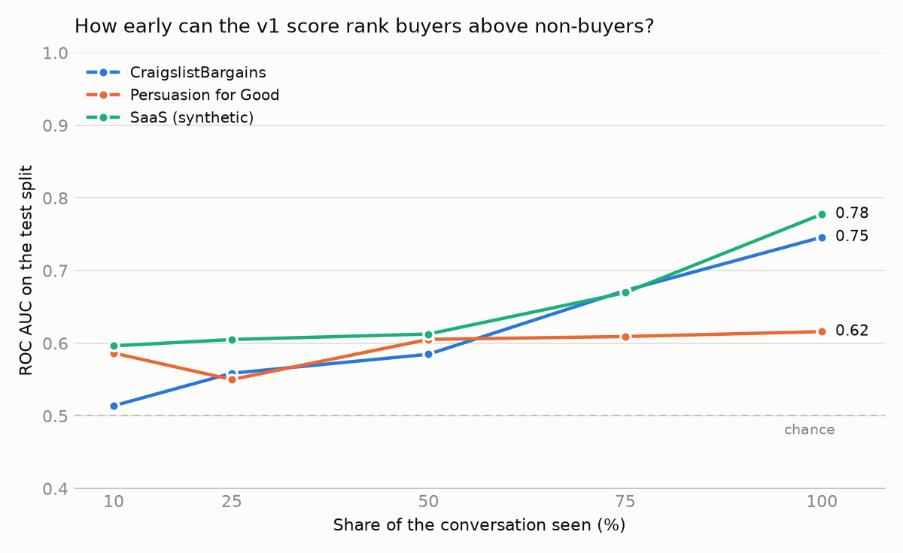
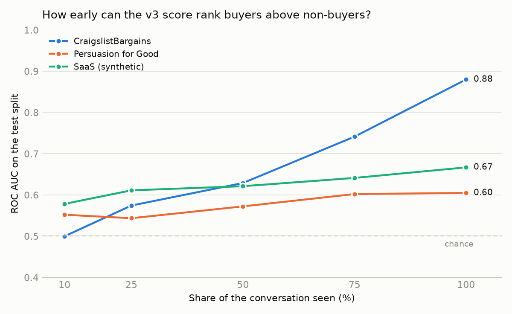
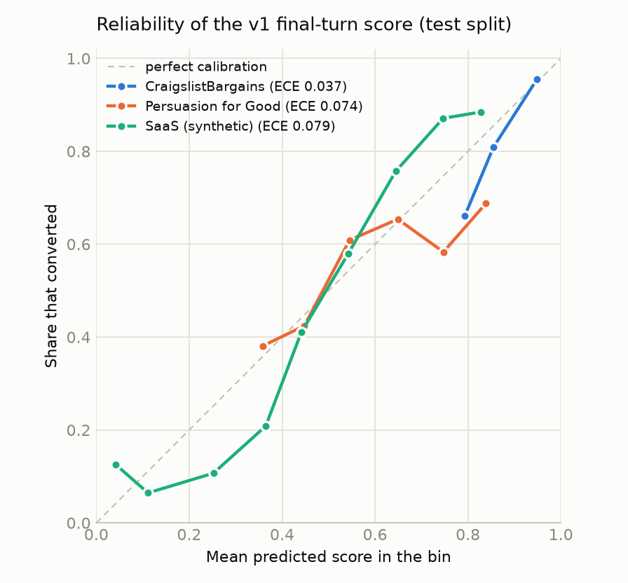
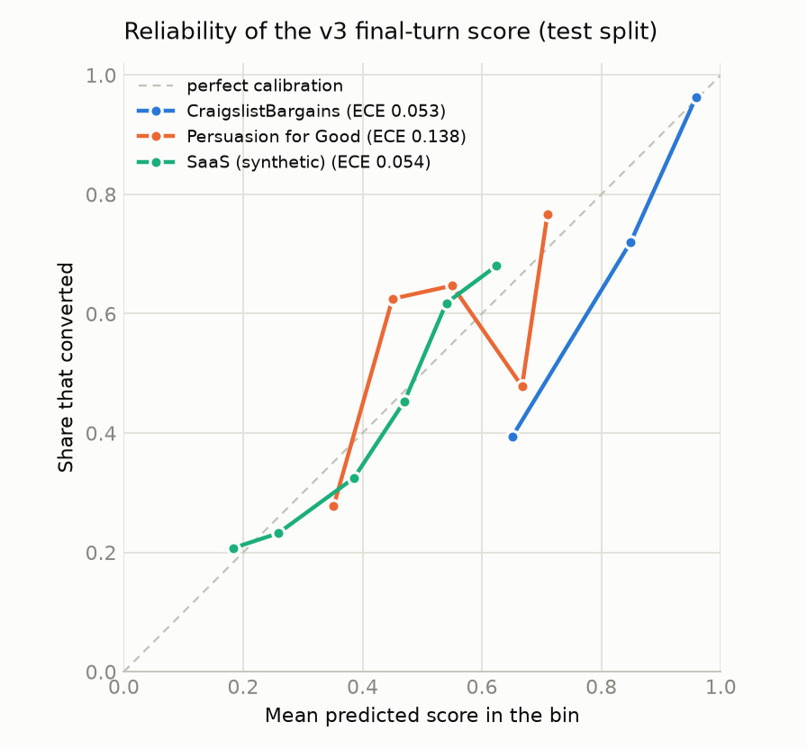

# Evaluation report

Generated by `make eval`. Unless stated otherwise, numbers are on the **test** split and
use the final-turn score, calibrated on the validation split.

- **v1**: logistic regression on rule-based cue counts and TF-IDF.
- **v3**: fine-tuned `distilroberta-base` (the fallback for ModernBERT-base on a 4 GB GPU).
- **v2** (LLM rubric) was not run.

## 1. Outcome prediction

| dataset | model | n | base rate | ROC AUC (95% CI) | PR AUC | Brier | Brier, base-rate baseline | ECE |
|---|---|---|---|---|---|---|---|---|
| CraigslistBargains | v1 | 670 | 85.8% | 0.746 (0.698–0.791) | 0.943 | 0.113 | 0.122 | 0.037 |
| CraigslistBargains | v3 | 670 | 85.8% | 0.880 (0.847–0.910) | 0.974 | 0.099 | 0.122 | 0.053 |
| Persuasion for Good | v1 | 153 | 53.6% | 0.616 (0.527–0.701) | 0.636 | 0.247 | 0.249 | 0.074 |
| Persuasion for Good | v3 | 153 | 53.6% | 0.605 (0.515–0.691) | 0.646 | 0.247 | 0.249 | 0.138 |
| SaaS (synthetic) | v1 | 3,000 | 49.9% | 0.778 (0.762–0.793) | 0.760 | 0.202 | 0.250 | 0.079 |
| SaaS (synthetic) | v3 | 3,000 | 49.9% | 0.667 (0.648–0.686) | 0.625 | 0.232 | 0.250 | 0.054 |

The majority-class baseline has ROC AUC 0.5 and PR AUC equal to the base rate.

## 2. Early prediction

ROC AUC using only the score at the given share of each conversation's turns.

| dataset | model | 10% | 25% | 50% | 75% | 100% |
|---|---|---|---|---|---|---|
| CraigslistBargains | v1 | 0.514 | 0.559 | 0.585 | 0.673 | 0.746 |
| CraigslistBargains | v3 | 0.500 | 0.574 | 0.629 | 0.741 | 0.880 |
| Persuasion for Good | v1 | 0.586 | 0.550 | 0.605 | 0.609 | 0.616 |
| Persuasion for Good | v3 | 0.552 | 0.543 | 0.572 | 0.602 | 0.605 |
| SaaS (synthetic) | v1 | 0.596 | 0.605 | 0.613 | 0.670 | 0.778 |
| SaaS (synthetic) | v3 | 0.578 | 0.611 | 0.621 | 0.641 | 0.667 |

## 3. Lead ranking

Share of the top-ranked test conversations that converted.

| dataset | model | base rate | precision@10 | precision@20 |
|---|---|---|---|---|
| CraigslistBargains | v1 | 85.8% | 100% | 100% |
| CraigslistBargains | v3 | 85.8% | 100% | 100% |
| Persuasion for Good | v1 | 53.6% | 70% | 70% |
| Persuasion for Good | v3 | 53.6% | 80% | 80% |
| SaaS (synthetic) | v1 | 49.9% | 100% | 95% |
| SaaS (synthetic) | v3 | 49.9% | 90% | 90% |

## 4. Calibration

Expected calibration error (ECE) is in the table of section 1. In the diagrams, a point
on the dashed line means the predicted score matches the share that really converted.
Bins with fewer than 10 conversations are not drawn (they still count in the ECE).

## 5. Agreement with annotators

Labels cover 60 fixed test-split conversations (`annotation/sample.json`).

| annotator | kind | conversations | customer turns | more / same / less | turning points |
|---|---|---|---|---|---|
| auto_llm | **LLM** | 60 | 416 | 138 / 207 / 71 | 33 |

> **There are no human labels yet.** Every number in this section is agreement with
> an **LLM annotator**, not with people. Treat it as indicative only.

### Direction of the score (up / same / down)

For each labelled customer turn after turn 0, the score's change from the previous turn
is called *same* when it is within ±0.02 and *up* or *down*
otherwise, and compared with the label (more / same / less).

| annotator | model | dataset | turns | accuracy | always-"same" accuracy | Cohen's kappa |
|---|---|---|---|---|---|---|
| auto_llm (LLM) | v1 | All datasets | 382 | 42.9% | 51.8% | 0.125 |
| auto_llm (LLM) | v1 | CraigslistBargains | 70 | 50.0% | 37.1% | 0.162 |
| auto_llm (LLM) | v1 | Persuasion for Good | 207 | 41.1% | 58.9% | 0.084 |
| auto_llm (LLM) | v1 | SaaS (synthetic) | 105 | 41.9% | 47.6% | 0.146 |
| auto_llm (LLM) | v3 | All datasets | 382 | 45.3% | 51.8% | 0.040 |
| auto_llm (LLM) | v3 | CraigslistBargains | 70 | 44.3% | 37.1% | 0.035 |
| auto_llm (LLM) | v3 | Persuasion for Good | 207 | 47.3% | 58.9% | 0.005 |
| auto_llm (LLM) | v3 | SaaS (synthetic) | 105 | 41.9% | 47.6% | -0.029 |

### Turning points

A predicted turning point counts as correct when a labelled one lies within ±1 turn.

| annotator | model | method | dataset | predicted | labelled | precision | recall | F1 |
|---|---|---|---|---|---|---|---|---|
| auto_llm (LLM) | v1 | A: score change | All datasets | 24 | 33 | 12% | 9% | 0.11 |
| auto_llm (LLM) | v1 | A: score change | CraigslistBargains | 0 | 11 | n/a | 0% | n/a |
| auto_llm (LLM) | v1 | A: score change | Persuasion for Good | 17 | 12 | 18% | 25% | 0.21 |
| auto_llm (LLM) | v1 | A: score change | SaaS (synthetic) | 7 | 10 | 0% | 0% | n/a |
| auto_llm (LLM) | v1 | B: change point | All datasets | 33 | 33 | 6% | 6% | 0.06 |
| auto_llm (LLM) | v1 | B: change point | CraigslistBargains | 0 | 11 | n/a | 0% | n/a |
| auto_llm (LLM) | v1 | B: change point | Persuasion for Good | 22 | 12 | 9% | 17% | 0.12 |
| auto_llm (LLM) | v1 | B: change point | SaaS (synthetic) | 11 | 10 | 0% | 0% | n/a |
| auto_llm (LLM) | v3 | A: score change | All datasets | 22 | 33 | 14% | 9% | 0.11 |
| auto_llm (LLM) | v3 | A: score change | CraigslistBargains | 3 | 11 | 33% | 9% | 0.14 |
| auto_llm (LLM) | v3 | A: score change | Persuasion for Good | 18 | 12 | 11% | 17% | 0.13 |
| auto_llm (LLM) | v3 | A: score change | SaaS (synthetic) | 1 | 10 | 0% | 0% | n/a |
| auto_llm (LLM) | v3 | B: change point | All datasets | 33 | 33 | 12% | 12% | 0.12 |
| auto_llm (LLM) | v3 | B: change point | CraigslistBargains | 5 | 11 | 0% | 0% | n/a |
| auto_llm (LLM) | v3 | B: change point | Persuasion for Good | 23 | 12 | 17% | 33% | 0.23 |
| auto_llm (LLM) | v3 | B: change point | SaaS (synthetic) | 5 | 10 | 0% | 0% | n/a |

### Agreement between annotators

Pending: Cohen's kappa between annotators needs at least two annotators, and only one label file exists.

## 6. Turning points and explanation faithfulness

Turning points found on the test split by the two methods.

| dataset | model | method | points | per conversation | conversations with at least one | share that are rises |
|---|---|---|---|---|---|---|
| CraigslistBargains | v1 | A: score change | 14 | 0.02 | 2% | 57% |
| CraigslistBargains | v1 | B: change point | 25 | 0.04 | 4% | 96% |
| CraigslistBargains | v3 | A: score change | 141 | 0.21 | 13% | 44% |
| CraigslistBargains | v3 | B: change point | 104 | 0.16 | 14% | 68% |
| Persuasion for Good | v1 | A: score change | 105 | 0.69 | 54% | 45% |
| Persuasion for Good | v1 | B: change point | 160 | 1.05 | 78% | 54% |
| Persuasion for Good | v3 | A: score change | 107 | 0.70 | 48% | 40% |
| Persuasion for Good | v3 | B: change point | 141 | 0.92 | 69% | 55% |
| SaaS (synthetic) | v1 | A: score change | 855 | 0.28 | 26% | 56% |
| SaaS (synthetic) | v1 | B: change point | 1,462 | 0.49 | 44% | 48% |
| SaaS (synthetic) | v3 | A: score change | 140 | 0.05 | 4% | 16% |
| SaaS (synthetic) | v3 | B: change point | 413 | 0.14 | 13% | 9% |

**Faithfulness** (method A, test split): mean absolute score change when the trigger turn
is removed and the conversation is re-scored, against removing one random other turn of
the same conversation. A faithful explanation should move the score much more.

| dataset | model | turning points | trigger removed | random turn removed | ratio | trigger effect is larger | flagged weak |
|---|---|---|---|---|---|---|---|
| CraigslistBargains | v1 | 14 | 0.113 | 0.035 | 3.2x | 64% | 29% |
| CraigslistBargains | v3 | 141 | 0.115 | 0.046 | 2.5x | 65% | 38% |
| Persuasion for Good | v1 | 105 | 0.191 | 0.031 | 6.2x | 98% | 0% |
| Persuasion for Good | v3 | 107 | 0.162 | 0.044 | 3.7x | 84% | 15% |
| SaaS (synthetic) | v1 | 855 | 0.183 | 0.032 | 5.7x | 98% | 0% |
| SaaS (synthetic) | v3 | 140 | 0.173 | 0.032 | 5.4x | 89% | 7% |

## 7. Cross-domain transfer

ROC AUC of the final-turn score on each dataset's test split, for a model trained on the
dataset in the row. Scores are uncalibrated here, which does not affect AUC. The diagonal
is the in-domain result; it can differ slightly from section 1 because calibration
creates ties between scores.

**v1**

| trained on \ tested on | CraigslistBargains | Persuasion for Good | SaaS (synthetic) |
|---|---|---|---|
| CraigslistBargains | **0.752** | 0.597 | 0.593 |
| Persuasion for Good | 0.581 | **0.616** | 0.572 |
| SaaS (synthetic) | 0.586 | 0.553 | **0.778** |

**v3**

| trained on \ tested on | CraigslistBargains | Persuasion for Good | SaaS (synthetic) |
|---|---|---|---|
| CraigslistBargains | **0.884** | 0.616 | 0.616 |
| Persuasion for Good | 0.584 | **0.605** | 0.524 |
| SaaS (synthetic) | 0.487 | 0.491 | **0.668** |

## 8. Case studies

Picked automatically from the test split, using each dataset's best model by ROC AUC.
Open one in the dashboard with `http://localhost:8501/Conversation_View?conversation=<id>`.

### CraigslistBargains (v3)

**Confident and correct**

- `craigslist-validation-557` — "VINTAGE SCHWINN COLLEGIATE": final score 99%, converted (10 turns, 0 turning points).
- `craigslist-validation-371` — "Zenith Trans Oceanic Shortwave Radio Vintage": final score 99%, converted (9 turns, 0 turning points).
- `craigslist-validation-31` — "MUST SEE!! Beautiful new kitchen and bathroom, Great neighborhood!!!": final score 99%, converted (14 turns, 0 turning points).

**Confident mistake**

- `craigslist-train-2945` — "Everything is Brand New Home With Nice Yard 说": final score 94%, did not convert (6 turns, 0 turning points).
- `craigslist-train-1488` — "Adorable Furnished Cottage June 15-Aug 15": final score 94%, did not convert (9 turns, 0 turning points).
- `craigslist-train-1528` — "Kicker 10" with amp and enclosure": final score 94%, did not convert (8 turns, 0 turning points).

**Largest turning point**

- `craigslist-train-1832` — "Binox-HD 4-16x binoculars": -44 points at turn 11. Interest dropped right after the agent stating the price.
- `craigslist-train-1163` — "2003 Chevy Express 3500 Cargo Van": -42 points at turn 10. Interest dropped right after the agent's message.
- `craigslist-train-4829` — "Charming Pet Friendly Community": +41 points at turn 10. Interest rose after a commitment to go ahead.

### Persuasion for Good (v1)

**Confident and correct**

- `p4g-20180903-155911_448_live` — "Donation chat #419": final score 89%, converted (21 turns, 0 turning points).
- `p4g-20180723-064816_188_live` — "Donation chat #557": final score 11%, did not convert (21 turns, 1 turning points).
- `p4g-20180828-180205_798_live` — "Donation chat #191": final score 89%, converted (22 turns, 1 turning points).

**Confident mistake**

- `p4g-20180826-054344_65_live` — "Donation chat #495": final score 89%, did not convert (20 turns, 0 turning points).
- `p4g-20180830-200148_992_live` — "Donation chat #836": final score 88%, did not convert (20 turns, 0 turning points).
- `p4g-20180902-022448_481_live` — "Donation chat #648": final score 15%, converted (20 turns, 1 turning points).

**Largest turning point**

- `p4g-20180828-202206_260_live` — "Donation chat #182": +35 points at turn 1. Interest rose after a commitment to go ahead.
- `p4g-20180827-025236_792_live` — "Donation chat #972": +33 points at turn 1. Interest rose after the customer's reply, following the agent explaining a benefit.
- `p4g-20180826-192022_0_live` — "Donation chat #503": +31 points at turn 1. Interest rose after a positive reaction, following the agent creating urgency.

### SaaS (synthetic) (v1)

**Confident and correct**

- `saas-8-conv-2709` — "Workflow Genie · saas-8-conv-2709": final score 99%, converted (11 turns, 1 turning points).
- `saas-16-conv-2886` — "SmartContent Pro · saas-16-conv-2886": final score 99%, converted (13 turns, 2 turning points).
- `saas-15-conv-3948` — "EcoVirtual Desktop · saas-15-conv-3948": final score 99%, converted (13 turns, 1 turning points).

**Confident mistake**

- `saas-10-conv-1692` — "AR Renewable Insights · saas-10-conv-1692": final score 1%, converted (11 turns, 2 turning points).
- `saas-12-conv-4379` — "SmartLLM Platform · saas-12-conv-4379": final score 1%, converted (18 turns, 1 turning points).
- `saas-17-conv-4351` — "DevOps Automation Suite · saas-17-conv-4351": final score 1%, converted (11 turns, 1 turning points).

**Largest turning point**

- `saas-12-conv-4379` — "SmartLLM Platform · saas-12-conv-4379": -58 points at turn 13. Interest dropped after a very short, disengaged reply, following the agent addressing an objection.
- `saas-13-conv-3935` — "SyncERP · saas-13-conv-3935": -46 points at turn 1. Interest dropped after a mention of an alternative, following the agent asking a question.
- `saas-17-conv-4351` — "DevOps Automation Suite · saas-17-conv-4351": -46 points at turn 8. Interest dropped after a very short, disengaged reply, following the agent addressing an objection.

## 9. Rule tagger against the Gemini tagger

The Gemini cue tagger has not been run, so there is nothing to compare.
